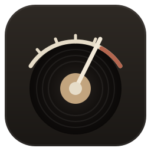
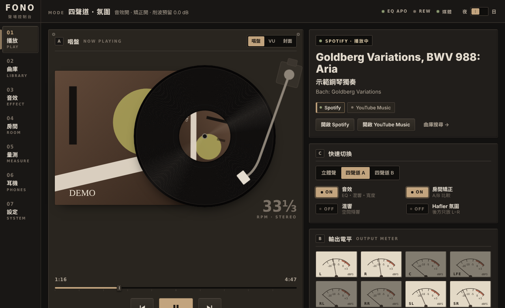

<a id="top"></a>
<p align="center"></p>

<h1 align="center">Fono Console</h1>
<p align="center"><b>Room correction, phase correction, headphone EQ and a vinyl-shelf music library for Windows, on top of Equalizer APO.</b></p>

<p align="center"><b>English</b> | <a href="#fono-console-繁體中文">中文</a></p>

<p align="center">
<a href="https://lectorlector.github.io/fono-console/">Live demo &amp; guide</a> ·
<a href="https://github.com/LectorLector/fono-console/releases/latest">Download</a> ·
<a href="ROADMAP.md">Roadmap</a> ·
<a href="docs/tutorial.en.md">Tutorial (text)</a> ·
<a href="docs/ai-workflow.en.md">AI workflow</a>
</p>



## Why

Windows has excellent free DSP (Equalizer APO) and excellent free measurement software (REW), but getting from "I have speakers and a mic" to "my room is corrected and stays corrected" still takes an afternoon of reading forums. Fono Console does that path in one window:

- **One-click room correction**: routes each speaker on its own, plays a log sweep with a loop-back timing reference, then works out arrival time, polarity and room modes. It fits cut-only peaking filters up to the Schroeder frequency, with 1/3/5-position averaging. No REW needed, though REW is supported.
- **ART-style active bass control (experimental)**: measure the speakers at 9 or 15 positions and let a set of "helper" speakers absorb the bass modes the main speakers excite. The helpers are the rear pair (4.x) or the subwoofers (2.1 / 2.2 / 4.1 / 4.2). New in v2.9.0: regularisation (lambda) and the drive limit are chosen automatically per band by leave-one-out cross-validation, the speakers are protected (no extra drive below each one's -10 dB point or where the SNR is low) and the required preamp attenuation is shown, pre-ringing can be limited (off by default), seat-position weights are editable, measuring is guided by a position grid with a per-point quality check and "redo this point", and a verification loop re-measures 3 or 5 positions with ART on and compares measured against predicted decay with an honest improved / no change / worse verdict. A collapsible "What is this?" panel explains what to expect. In a simulated bedroom the modal decay at 40-63 Hz is cut by about 25-50%; real rooms vary, so trust the verification measurement. Study: [research/art](research/art/README.md).
- **Subwoofer layouts (2.1 / 2.2 / 4.1 / 4.2)**: SW1 goes to the sound card's LFE output and SW2 to C (changeable in Channel mapping). Bass management uses an LR4 crossover (default 80 Hz, adjustable on the Room page): the mains are high-passed (or kept full range) and each sub gets a low-pass of the (L+R)/2 sum with its own gain, delay and polarity. The measurement wizard measures the subs too and searches the delay (+-10 ms) and polarity that make the sum largest at the seat; "Apply sub alignment" writes the result. Sub level is set by ear.
- **Room diagnosis and seat heatmap**: a "Room diagnosis" tab on the Measure page ranks the findings by severity in plain language (left/right balance and arrival, polarity, bass peaks and dips with the seat's position in the room mode, bass unevenness at the seat, early reflections with a mirror point, SNR and clipping, sub/mains blend, decay, EQ limits), each with a concrete action, and exports an HTML report. A seat heatmap on the floor plan shows the predicted 30-120 Hz unevenness at every point, outlines the best area and updates as you drag the seat or the speakers.
- **FIR phase correction**: linear-phase all-pass FIR that removes the speaker's excess phase (crossover and port roll-off), computed from a measurement or from a crossover model. Latency is identical at every sample rate.
- **Speaker layout**: the wizard asks whether you have headphones only, a 2.0 pair, front + rear pairs (4.0), and whether to add one or two subwoofers (2.1, 2.2, 4.1, 4.2). Pages and keys that do not apply are hidden (nothing is deleted), the 2.0 config mutes the rear channels, and measurement, FIR and ART only list the speakers you have. Change it later in Settings.
- **Multichannel listening modes**: stereo, quad-A (delayed ambience), quad-B (bass reinforcement) and Hafler difference surround. The Windows default device follows the mode.
- **Measurement guard**: a sweep that records no signal (amp off, wrong input) stops with a plain explanation instead of fitting noise.
- **Target curve editor**: drag nodes on a log-frequency graph (flat, room curve, warm, bright) and the auto-EQ follows it; the old bass-rise knob is the default shelf.
- **Decay analysis**: EDT, T20 and T30 per octave band from the measured impulse response, plus a waterfall (CSD) plot.
- **Mic pairing and calibration files**: pair two microphones on the same speaker so they read alike, or import a UMIK-style `.txt` calibration file.
- **Equal-loudness compensation (experimental)**: an ISO 226 low/high shelf pair that restores bass and treble when you listen quietly.
- **Lab modules (experimental)**: ART (robust over +-1 % temperature variants, with a decay report), room scan import with a draggable floor plan, first-reflection mirror points matched to measured peaks, and room-mode pressure at your seat with a seat-move suggestion.
- **Headphones**:
  - A profile per device.
  - AutoEq database search, bass/treble, crossfeed.
  - Bluetooth battery level and the hands-free (mono) switch.
  - A stereo DAC can switch between speakers and headphones.
- **Library**: Spotify and YouTube Music searched together. Albums and playlists are record sleeves that slide open, and switching sources pauses the other player.
- **Looks**:
  - Four panel skins (mixing desk, walnut hi-fi, aluminium deck, graphite studio), light/dark and any accent colour.
  - Ten colour palettes plus a custom five-colour palette with a contrast warning.
  - Panel textures (grain, brushed metal, wood, leather, felt, linen, paper, carbon, crackle) and wallpapers: built-in pixel-art and woodblock tributes to public-domain paintings, or upload your own, with dim, blur and panel transparency.
  - Theme export / import.
- **Player**: turntable (ten vinyl colours, four decks, dust lid), cassette deck (shell colours), big VU, big cover and minimal layouts. Needle, LED and nixie meters, and the animations follow the music.
- **Widgets and custom pages**: "Edit layout" lets you drag, resize and hide every panel and reorder or hide rail pages. Add your own pages on a 12-column grid and fill them with widgets (now playing, mini turntable, VU, quick switches, clock, sleep timer, SPL / amp-speaker / delay / room-mode calculators, test tone, notes). Layouts export and import.
- **Tours**: the in-app tour and the tutorial site cover the new pieces, including "Subwoofer setup", "Room diagnosis" and "Customise look and layout" flows. A first-run wizard step picks skin, palette, wallpaper and player style for you.
- **Flat, hardware-style UI**: low-saturation panels, lit ON/OFF keys, no decorative shapes. The UI and the guide are available in Traditional Chinese and English.
- **Setup wizard**: asks what you want to do, installs Equalizer APO (official installer bundled), picks devices, takes over `config.txt` with a backup, and installs and wires up YouTube Music (hash-verified) and Spotify.

Everything runs locally: the server listens on `127.0.0.1` only, and tokens and settings stay in `%APPDATA%\FonoConsole`.

## Get started

1. Download `FonoConsole-x.y.z.zip` from [Releases](https://github.com/LectorLector/fono-console/releases/latest) and unzip it.
2. Run `FonoConsole.exe`. The setup wizard opens on first launch.
3. Reboot once if you added devices in Equalizer APO's Device Selector.
4. Follow the guide for what you want to do: room, headphones, library…

The [interactive guide](https://lectorlector.github.io/fono-console/) (English and 中文) runs the real interface in your browser with a simulated backend, and each tutorial plays itself step by step. The same guide is built into the app (Settings → Tutorial site) and works offline.

A command-line version of the wizard is included: `scripts\setup.cmd` (`-Step 3,9` runs only some steps). For a text walk-through see the [tutorial](docs/tutorial.en.md).

## Build

Go 1.24+, no third-party Go modules, and no Node/npm: the UI is plain ES modules embedded with `go:embed`.

```sh
scripts/build.sh                 # cross-compile from Linux/macOS → dist/FonoConsole.exe
scripts\build.ps1                # on Windows
go run . --demo                  # any OS: simulated devices and media at http://127.0.0.1:47811
scripts/package.sh 2.6.0         # release zip with the bundled Equalizer APO installer
```

```sh
go vet ./... && go test ./... && node tests/run.mjs   # unit tests, no npm dependencies; same as CI
node tests/ui-sweep.mjs                               # optional browser sweep (needs playwright + Chromium)
```

Tags `v*` build a release, and pushes to `docs/` or `web/` deploy the guide to GitHub Pages (`.github/workflows`).

### Architecture

```
FonoConsole.exe (Go)
 ├─ 127.0.0.1:47811   HTTP + server-sent events; UI opens in an Edge/Chrome app window
 │   ├─ /               web/ (embedded UI)          /guide/  docs/ (embedded guide + live demo)
 │   ├─ /api/eapo/*     writes fono_console.txt, IR and FIR wav files for Equalizer APO
 │   ├─ /api/setup/*    setup wizard: installers (hash-verified), YouTube Music API, Chrome policy
 │   ├─ /api/spotify/*  PKCE OAuth + Web API proxy        /api/ytm/*  YouTube Music desktop API
 │   ├─ /api/autoeq/*   AutoEq index and profiles (cached) /api/rew/*  REW API proxy
 └─ assets/bridge.ps1   resident PowerShell: media sessions (SMTC), Core Audio meters,
                        default device, device list, Bluetooth battery/connection
web/js/   eapo.js (config generator) · measure.js (sweep, deconvolution, auto-EQ) · fir.js
          (excess phase, FIR design) · library.js · headphones.js · setup.js · mock.js (demo backend)
```

## Contributing

Issues and pull requests are welcome, especially:

- measurement data from real rooms (before/after)
- testing with other sound cards and mics
- translations and wording fixes (the UI and docs are Traditional Chinese + English)
- the items in the [roadmap](ROADMAP.md): binaural headphone measurement, virtual speakers, parametric EQ editor

## Credits & licenses

MIT © Fono Console contributors. Equalizer APO (GPLv2) is bundled unmodified, and YouTube Music desktop (MIT) is downloaded and verified by the wizard. AutoEq (MIT) data is read on demand. REW is not redistributable and is only linked. Details: [THIRD_PARTY.md](THIRD_PARTY.md). Spotify and YouTube are trademarks of their owners; this project is not affiliated with them.

---

<a id="fono-console-繁體中文"></a>

<h1 align="center">Fono Console 繁體中文</h1>
<p align="center"><b>Windows 上的聲場控制台：一鍵房間量測與矯正、FIR 相位校正、耳機 AutoEq、Spotify／YouTube Music 唱片架，全部建立在 Equalizer APO 上。</b></p>

<p align="center"><a href="#top">English</a> | <b>中文</b></p>

<p align="center">
<a href="https://lectorlector.github.io/fono-console/?lang=zh">互動教學網站</a> ·
<a href="https://github.com/LectorLector/fono-console/releases/latest">下載</a> ·
<a href="ROADMAP.md">發展路線</a> ·
<a href="docs/tutorial.zh-TW.md">中文教學（純文字版）</a> ·
<a href="docs/ai-workflow.zh-TW.md">多 AI 開發流程</a>
</p>

## 為什麼做這個

Windows 上有很棒的免費 DSP（Equalizer APO）和免費量測軟體（REW），但從「我有喇叭和麥克風」到「房間已校正、而且一直維持校正」，往往還要花一個下午看論壇。Fono Console 把這條路放進同一個視窗：

- **一鍵房間校正**：逐顆喇叭單獨導出聲音，播放帶迴路計時參考的對數掃頻，算出抵達時間、極性與房間模態，並在施羅德頻率以下擬合只削峰的峰值濾波器，支援 1／3／5 點平均。不需要 REW，但也支援 REW。
- **ART 式低頻主動校正（實驗）**：以 9 或 15 個位置量測喇叭，讓一組「協助」喇叭吸掉主喇叭激起的低頻駐波；協助喇叭是後方一對（4.x）或重低音（2.1／2.2／4.1／4.2）。v2.9.0 新增：每個頻帶用留一交叉驗證自動挑正則化（λ）與推力上限；保護喇叭（低於各喇叭 −10 dB 點或訊噪比不足處不加大推力）並顯示需要的前級衰減；可限制預振鈴（預設關閉）；座位位置權重可編輯；量測有位置圖引導、每點品質檢查與「重量這一點」；套用後的「驗證量測」會用 3 或 5 個位置重量，把實測與預測的殘響時間並排，並誠實給出有改善／沒有明顯變化／變差的結論。可展開的「這是什麼？」面板說明預期效果。模擬臥室中 40–63 Hz 的模態衰減縮短約 25–50%；真實房間差異很大，請以驗證量測為準。研究見 [research/art](research/art/README.md)。
- **重低音配置（2.1／2.2／4.1／4.2）**：SW1 接音效卡的 LFE，SW2 預設接 C（可在「聲道對應」更改）。低音管理用 LR4 分頻（預設 80 Hz，在「房間」頁調整）：主喇叭高通（或保持全頻），每顆重低音對 (L+R)/2 做低通，並有自己的增益、延遲與極性。量測精靈也會量重低音，在 ±10 ms 內搜尋讓聽音位置加總最大的延遲與極性，按「套用重低音對齊」寫入；重低音音量用耳朵調。
- **房間診斷與座位熱圖**：量測頁的「房間診斷」分頁把結果依嚴重程度排成白話清單（左右平衡與到達時間、極性、低頻峰谷與座位在房間模態中的位置、座位的低頻起伏、早期反射與鏡像點、訊噪比與削波、重低音與主喇叭銜接、殘響、EQ 限制），每項附具體做法，並可匯出 HTML 報告。平面圖上的座位熱圖預測每一點 30–120 Hz 的起伏，圈出最佳區域，拖曳座位或喇叭時即時更新。
- **FIR 相位校正**：線性相位全通 FIR，移除喇叭的超額相位（分頻器與倒相孔滾降），可由量測或分頻器模型計算，各取樣率延遲一致。
- **喇叭配置**：精靈會問你是只有耳機、2.0 一對喇叭、前後兩對（4.0），以及要不要加一或兩顆重低音（2.1、2.2、4.1、4.2）。用不到的頁面與按鍵會收起來（不刪資料），2.0 配置會將後方聲道靜音，量測、FIR、ART 只列出你有的喇叭（含重低音）。之後可在設定改。
- **多聲道聆聽模式**：立體聲、四聲道 A（延遲氛圍）、四聲道 B（低頻補強）與 Hafler 差訊號環繞，Windows 預設裝置跟著模式切換。
- **量測防呆**：掃頻沒有錄到訊號（擴大機沒開、輸入選錯）時，會停下並用白話說明，而不是去擬合雜訊。
- **目標曲線編輯器**：在對數頻率圖上拖曳節點（平直、房間曲線、暖、亮），自動 EQ 追著它走；舊的低頻抬升旋鈕成為預設的低頻擱架。
- **衰減分析**：由量得的脈衝響應算出每個倍頻帶的 EDT、T20、T30，並繪製瀑布圖（CSD）。
- **麥克風配對與校正檔**：兩支麥克風量同一顆喇叭，讓它們讀數一致；也能匯入 UMIK 類 `.txt` 校正檔。
- **等響度補償（實驗）**：ISO 226 低頻／高頻擱架組合，小聲聽時補回低音與高音。
- **實驗室模組（實驗）**：ART（對 ±1% 室溫變化穩健，附衰減報告）、房間掃描匯入與可拖曳平面圖、對應量測峰值的早期反射鏡像點，以及座位處的房間模態聲壓與移位建議。
- **耳機**：
  - 每個裝置一組設定。
  - AutoEq 資料庫搜尋、低音／高音、交叉饋送。
  - 藍牙電量與免持（單聲道）開關。
  - 立體聲 DAC 可在喇叭與耳機間切換。
- **曲庫**：Spotify 與 YouTube Music 一起搜尋。專輯與歌單是會滑開的唱片封套，換來源時自動暫停另一個播放器。
- **外觀**：
  - 四種面板（混音台、胡桃木 Hi-Fi、鋁面卡座、石墨錄音室）、深淺色與任意強調色。
  - 十種配色，加一組五色自訂配色並提示對比不足。
  - 面板材質（顆粒、髮絲紋、木紋、皮革、毛氈、亞麻、紙張、碳纖維、龜裂漆）與桌布：內建向公有領域名畫致敬的像素與版畫風景，或上傳自己的圖片，可調壓暗、模糊與面板透明度。
  - 主題匯出／匯入。
- **播放頁**：唱盤（十種黑膠顏色、四種唱盤、防塵蓋）、卡帶機（外殼顏色）、大型 VU 表、大封面與極簡版面；指針、LED、輝光管三種儀表，動畫跟著音樂走。
- **小工具與自訂分頁**：「編輯版面」可拖曳、縮放、隱藏每個面板，並重排或隱藏導覽列頁面。可在 12 欄格線上新增自己的分頁，放進小工具（正在播放、迷你唱盤、VU、快速開關、時鐘、睡眠計時器、SPL／擴大機搭配／延遲／房間模態速算、測試音、便條）。版面可匯出與匯入。
- **導覽**：應用程式內導覽與教學網站涵蓋這些新功能，包括「重低音設定」「房間診斷」與「自訂外觀與版面」流程。首次執行的精靈步驟會幫你挑面板、配色、桌布與播放頁樣式。
- **扁平的硬體風介面**：低彩度面板、會亮的 ON／OFF 鍵、沒有裝飾圖形。介面與教學提供繁體中文與英文。
- **設定精靈**：先問你想做什麼，安裝 Equalizer APO（隨附官方安裝程式），選裝置，備份後接管 `config.txt`，並安裝與串接 YouTube Music（比對雜湊）和 Spotify。

一切都在本機執行：伺服器只聽 `127.0.0.1`，token 與設定只存在 `%APPDATA%\FonoConsole`。

## 開始使用

1. 到 [Releases](https://github.com/LectorLector/fono-console/releases/latest) 下載 `FonoConsole-x.y.z.zip` 並解壓縮。
2. 執行 `FonoConsole.exe`，第一次啟動會開啟設定精靈。
3. 如果在 Equalizer APO 的 Device Selector 新增了裝置，重新開機一次。
4. 照你想做的事看教學：房間、耳機、曲庫……

[互動教學網站](https://lectorlector.github.io/fono-console/?lang=zh)在瀏覽器裡執行真正的介面（接模擬的後端），每段教學都會自己一步一步示範。同一份教學內建在應用程式裡（設定 → 教學網站），可離線使用。

壓縮檔內附命令列版精靈：`scripts\setup.cmd`（`-Step 3,9` 只執行其中幾步）。純文字教學見[中文教學](docs/tutorial.zh-TW.md)。

## 建置

需要 Go 1.24 以上，不使用第三方 Go 模組，也不需要 Node／npm：介面是純 ES 模組，以 `go:embed` 嵌入。

```sh
scripts/build.sh                 # 在 Linux/macOS 交叉編譯 → dist/FonoConsole.exe
scripts\build.ps1                # 在 Windows 上
go run . --demo                  # 任何系統：模擬裝置與媒體，網址 http://127.0.0.1:47811
scripts/package.sh 2.6.0         # 含 Equalizer APO 安裝程式的發行 zip
```

```sh
go vet ./... && go test ./... && node tests/run.mjs   # 單元測試，不需 npm 套件；與 CI 相同
node tests/ui-sweep.mjs                               # 選用的瀏覽器掃描（需 playwright 與 Chromium）
```

推送 `v*` 標籤會建置發行版；推送到 `docs/` 或 `web/` 會把教學網站部署到 GitHub Pages（`.github/workflows`）。

### 架構

見上方英文部分的架構圖（檔名與路徑相同）。伺服器只在本機提供介面、Equalizer APO 設定檔寫入、設定精靈、Spotify／YouTube Music／AutoEq／REW 的代理，以及負責媒體工作階段、音量表、預設裝置與藍牙電量的常駐 PowerShell。

## 參與貢獻

歡迎 Issue 與 Pull Request，特別是：

- 真實房間的量測資料（校正前後）
- 其他音效卡與麥克風的測試
- 翻譯與用字修正（介面與文件為繁體中文＋英文）
- [發展路線](ROADMAP.md)中的項目：雙耳耳機量測、虛擬喇叭、參數 EQ 編輯器

## 來源與授權

MIT © Fono Console contributors。Equalizer APO（GPLv2）以未修改的形式隨附，YouTube Music 桌面版（MIT）由精靈下載並驗證，AutoEq（MIT）資料於使用時讀取，REW 不可轉發，只提供連結。詳見 [THIRD_PARTY.md](THIRD_PARTY.md)。Spotify 與 YouTube 是其所有者的商標，本專案與它們無關。
