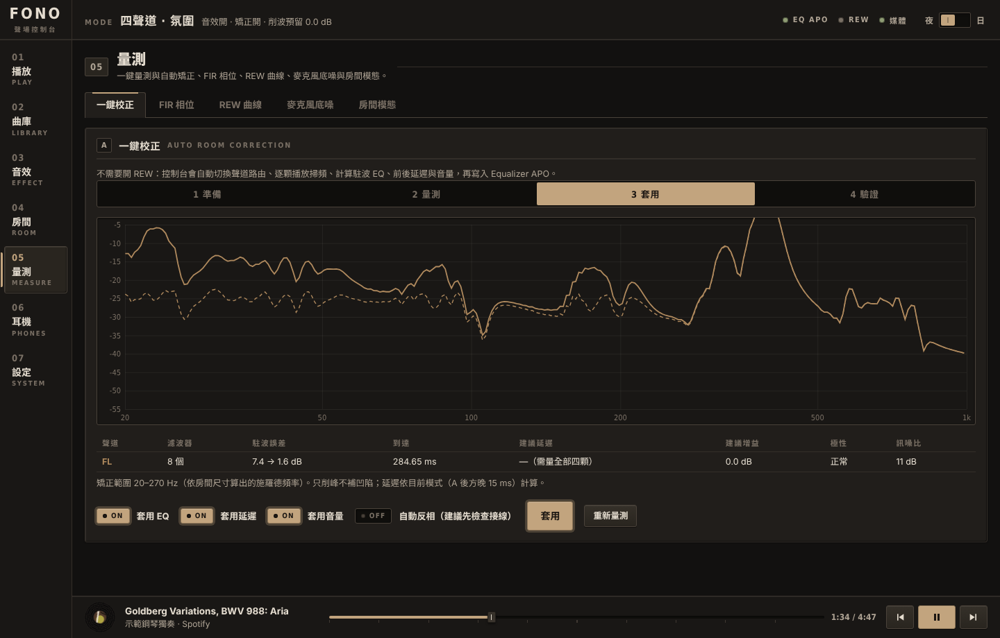
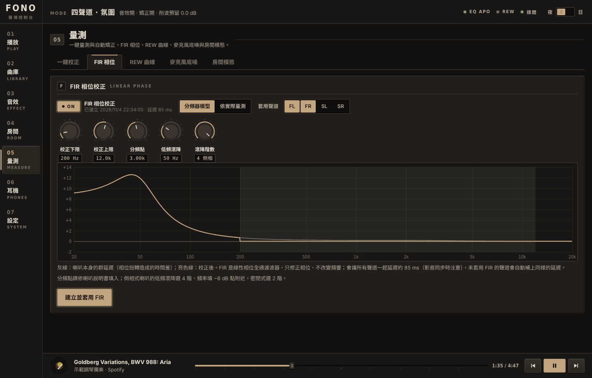
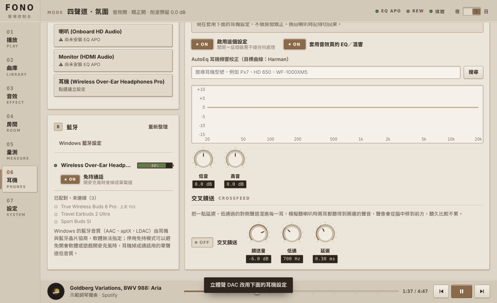

# Fono Console Tutorial

[English](tutorial.en.md) | [繁體中文](tutorial.zh-TW.md)

This tutorial starts from zero: install the software, measure the room, correct it, listen to music, set up headphones. You do not need to know REW or Equalizer APO syntax. Page names such as `05 Measure` follow the app's English interface (switch the language in Settings).

---

## 0. Three things to understand first

**Equalizer APO is the engine; Fono Console is the steering wheel.**

- Equalizer APO sits in the Windows audio stack, so all sound passes through it.
- Fono Console only generates its configuration file (`fono_console.txt`), so the effects stay in place after you close Fono Console.

**Correction mainly fixes the bass.**

- Below roughly 300 Hz a room produces standing waves: some frequencies boom, others nearly vanish. This is a much bigger effect than the differences between speakers, and it is where EQ helps most.
- The treble is better handled with speaker placement and absorption.
- Fono Console only corrects below the Schroeder frequency, and it **only cuts peaks and never fills dips**. A dip is caused by waves cancelling each other; adding energy will not fill it and only makes the amplifier clip.

**Two output devices, two jobs.** The setup asks about both:

| Name | Purpose | Example |
|---|---|---|
| Multichannel sound card | Quad modes: front L/R + rear SL/SR, each pair on its own amplifier | USB 7.1 sound card (CM6206 etc.) |
| Stereo DAC | Stereo mode: front pair only, on a better-sounding DAC | Any USB DAC |

With only one card, enter the same card for both.

**Reading the interface:**

| Element | How to read it | How to use it |
|---|---|---|
| Toggle key (`ON` / `OFF`) | Lit and reading ON = on; dark and reading OFF = off | Click to toggle |
| Knob | The small dark box below shows the current value | Drag up/down; hold Shift for fine steps; double-click to reset |
| Fader | The dark box above shows the value; the lit line in the middle is 0 dB | Drag up/down; double-click to reset |
| Segmented key (e.g. Stereo / Quad A / Quad B) | The lit segment is the current choice | Click one |
| Three lamps at the top | Green = fine, yellow = needs attention, grey = not connected | — |

---

## 1. Installation (about 10 minutes)

1. Put `FonoConsole.exe` and the `scripts` folder together.
2. Double-click `scripts\setup.cmd`. Each step explains itself and then asks: press Enter for the default, type `n` to skip.

   | Step | What it does | What you do |
   |---|---|---|
   | 1 Install | Copies to `%LOCALAPPDATA%\Programs\FonoConsole` and creates shortcuts | Nothing |
   | 2 Equalizer APO | Detects whether it is installed; opens the download page if not | In the installer's Device Selector, **tick the speaker outputs, not the microphones** |
   | 3 Devices | Lists all playback devices and marks whether EQ APO is on them | Type the numbers; you can name the four speakers |
   | 4 config.txt | Backs up the original, replaces it with a single `Include: fono_console.txt`, and makes it writable for your account | Click Yes in the UAC prompt |
   | 5 REW | Detects the install location (skippable) | Nothing |
   | 6 Spotify | Explains how to create a developer app | Paste the Client ID |
   | 7 YouTube Music | Downloads the desktop app from GitHub, **verifies the SHA-256**, enables the API server | Sign in once after installing |
   | 8 Chrome | Optional: stop background running, enable memory saver | Off by default |
   | 9 Save | Writes `%APPDATA%\FonoConsole\settings.json` | Nothing |

3. If you added devices in step 2, **reboot**.
4. To redo one step only: `scripts\setup.cmd -Step 6` (several steps: `-Step 3,9`).

### 1.1 Spotify developer app (step 6 in detail)

Only the library (search, open albums, playlists) needs this step. Playback control, cover art and progress do not.

1. Go to <https://developer.spotify.com/dashboard>, sign in and press **Create app**.
2. Set the Redirect URI to `http://127.0.0.1:47811/api/spotify/callback`. It must be 127.0.0.1; Spotify does not accept localhost.
3. Tick **Web API** and press Save. Open Settings, copy the Client ID and paste it back into the script.
4. Open Fono Console → `07 Settings` → **Connect Spotify**.

> Spotify's 2026 development-mode limits:
>
> - The app owner needs Premium.
> - Only accounts you add under User Management can sign in.
> - Tracks of other people's playlists are not visible; playlists you created or collaborate on are.

### 1.2 YouTube Music (step 7 in detail)

- Fono Console does not scrape web pages. It connects through the API server built into the open-source YouTube Music desktop app (pear-desktop), which accepts local connections only.
- The first time you search the library, YouTube Music shows an authorisation window. Press Allow.

---

## 2. Before measuring

- **Microphone position**: at the main listening position, at ear height. Use a stand or a stack of books; do not hold it.
- **Which input**: ideally plug it into the same sound card you are measuring, so timing stays synchronised. A laptop's built-in microphone is not recommended.
- **Environment**: switch off air conditioning and fans, close windows. `05 Measure` → `Mic noise floor` tells you whether the signal-to-noise ratio is sufficient.
- **Microphone level**: Windows Sound settings → Recording → Properties → Levels, set to 70–90, and turn off "Microphone boost" and all effects.
- **Amplifier volume**: set it to a fairly loud level for normal listening. The sweep level can be changed in the wizard (default −12 dBFS).
- **Fix placement before EQ**:
  - Keep speakers at least 50 cm from the rear wall.
  - Form an equilateral triangle between the two speakers and yourself, symmetrical left/right.
  - `05 Measure` → `Room modes`: enter the room dimensions to see which frequencies will be a problem.
- **Check the wiring**: on `01 Play`, turn the mode knob to "Channel ID" and use pink noise to confirm which speaker each jack drives.

---

## 3. One-click calibration

`05 Measure` → `One-click` → **Start one-click calibration**

1. **Prepare**: pick the output device (multichannel card) and input device (microphone), the channels to measure and the number of microphone positions. One position is fastest; for 3–5 positions, move the microphone within 30 cm around your head for a more robust result.
2. **Measure**: about 10 seconds per channel.
   - Fono Console routes the sound to a single speaker at a time, mutes the other channels and temporarily disables all effects.
   - The right channel also carries a reference signal that serves as the timing reference.
3. **Read the result**:

   

   | Column | Meaning |
   |---|---|
   | Filters | Number of peaking EQ filters fitted automatically |
   | Mode error | Mean deviation from the target curve (dB), shown as "before → after" |
   | Arrival | Time for sound to travel from the speaker to the microphone (relative) |
   | Suggested delay | Delay needed so all speakers arrive together; **only computed once all four are measured** |
   | Suggested gain | Level matching between channels; the rear pair gets another −6 dB in Quad A mode |
   | Polarity | Inverted polarity is flagged; check the wiring first |
   | SNR | Results below 15 dB are unreliable; measure again |

4. **Apply**: choose separately whether to apply EQ, delay, gain and automatic polarity inversion.
5. **Verify**: measure again and compare the curves before and after. You can also A/B compare in real time with the "Room correction" switch on `01 Play`.

**Bass rise** (default +2 dB) lifts the target curve slightly at low frequencies, which sounds more natural. Set it to 0 if you prefer clean, flat bass.

---

## 4. FIR phase correction

`05 Measure` → `FIR phase`

**Why it matters:**

- A speaker's crossover and low-frequency roll-off make some frequencies arrive late: the bass is often several milliseconds behind the treble, which dulls drum transients.
- Ordinary EQ changes the phase as well.
- An FIR filter can correct phase without touching the frequency response.

**Two modes:**

| Mode | Who it is for |
|---|---|
| Crossover model | You do not have a good measurement microphone. Enter the crossover frequency (it is in the manual; two-way bookshelf speakers are usually at 2–3.5 kHz), the low-frequency roll-off frequency and order (about 4th order for ported designs) |
| Measured | You have already run one-click calibration and trust your microphone |

**Adjusting and applying:**

- **Correction range**: default 200 Hz – 12 kHz. Extending lower corrects more bass phase, but increases latency and the risk of pre-ringing.
- **Latency**: fixed at about 85 ms at every sample rate. Channels without an FIR automatically get the same delay to stay in sync. The price is slightly off lip-sync in video; turn it off for gaming.
- The plot below: the grey line is the speaker's original group delay (how many milliseconds the bass arrives late), the bright line is the corrected one, which should lie flat at 0 inside the correction range.

   

- Press **Build and apply FIR**: this generates four WAV sets for 44.1 / 48 / 96 / 192 kHz, and Equalizer APO picks the one matching the current sample rate.

---

## 4.5 ART active bass control (experimental)

Bass problems in a small room are not only "some frequencies are too loud" but also "the boom lasts too long" (modal ringing). Ordinary EQ can flatten the peak but cannot shorten the decay. ART uses all four speakers: the rear speakers play a precisely calculated signal that absorbs the standing waves the front speakers excite.

1. In `Settings → Feature modules`, turn on **ART active bass control**.
2. In `Measure → One-click`, choose **15 positions** and measure all four speakers. The wizard tells you where to place the microphone at each point: head position, 25 cm front/back and left/right, 15 cm up/down. Do not run the air conditioning or move the speakers during measurement.
3. Open the **ART bass** tab and press "Calculate" to see the prediction table:
   - "Inside measured area": each point is predicted using filters computed from the other points.
   - "6 °C temperature change": behaviour when the room warms or cools; closest to everyday use.
   - Green is improvement, red is degradation.
4. If you are happy, press **Apply ART**; the mode switches to "ART bass". Use `Room` to switch back to other modes and compare.
5. After applying, run one-click calibration again to confirm the real-world result.

**Notes:**
- Filters can boost up to +12 dB. The console lowers the pre-amp automatically to protect the speakers, so overall volume is a little lower.
- Measure again after moving speakers or furniture.
- The crossover frequency defaults to 120 Hz. Higher, and a temperature change can easily make things worse.

Theory, simulations and limits: [research/art](../research/art/README.md).

## 4.6 Speaker layout (headphones / 2.0 / 4.0)

After "Choose output devices", the setup wizard asks how your speakers are connected and collapses everything you do not use (nothing is deleted). You can change it any time in `07 Settings → Speaker layout`.

| Layout | What changes |
|---|---|
| Headphones only | The "Room" and "Measure" pages are hidden; headphone features stay on |
| 2.0 stereo | Listening mode is fixed to stereo; Quad and Hafler keys are hidden; rear channels are muted; measurement and FIR list only FL/FR; the ART tab says "ART needs four speakers, front and rear (4.0 layout)" |
| 4.0 front + rear pairs | Everything (default) |

"Set everything up for me" does not change the layout you chose.

---

## 4.7 Customising look and layout

1. `07 Settings → Appearance`:
   - **Palettes**: ten presets and one custom palette (pick background, panel, text, accent and lamp colours; a contrast warning appears if it is too low).
   - **Textures**: surface texture for panels, side rail and top bar (grain, brushed metal, wood, leather, felt, linen, paper, carbon fibre, crackle varnish), with adjustable strength.
   - **Wallpapers**: built-in pixel-art and woodblock-style landscapes, or upload an image up to 8 MB; dim, blur and panel transparency are adjustable.
   - **Player page**: turntable, cassette deck, big VU meter, big cover, minimal; vinyl comes in ten colours, cassette shells are selectable; meters can be needle, LED or nixie.
   - "Export theme / Import theme" shares the whole look.
2. **Edit layout** at the top right: every panel can be dragged, resized or hidden; rail pages can be reordered or hidden. Press `Esc` or "Done" to finish.
3. While editing, the rail shows **+ Add page**: create a custom page, press "+ Add widget" and choose from the catalogue: now playing, mini turntable, VU meter, quick switches, clock, sleep timer, SPL / amp-speaker match / distance-delay / room-mode calculators, test tone, notes.
4. `Settings → Layout & widgets` exports, imports or resets the whole layout.

---

## 5. Listening modes

Switch with the mode knob on `01 Play`:

| Mode | Description |
|---|---|
| Stereo | Only the stereo DAC and the front speakers; the purest |
| Quad A | Front normal, rear −6 dB and delayed 15 ms, like a larger space |
| Quad B | Front and rear at equal level; good for background music and parties |
| Ambience (Hafler) | The rear plays only the left-minus-right difference signal: the reverberation and space in the recording come from behind, vocals stay in front |
| Channel ID / Measure routing | For wiring checks and measurement |

Switching modes also switches the Windows default output device. If you do not want that, turn off "Auto-switch default output" in `07 Settings`.

---

## 6. Headphones and Bluetooth

`06 Headphones`: every non-speaker output (wired headphones, Bluetooth headphones, USB amp) has its own profile. Whichever device Windows switches to, its profile is applied.

- **A stereo DAC can drive headphones too**: if your DAC has a headphone jack, it appears in the list with an extra "this DAC is connected to: speakers / headphones" switch on top. Equalizer APO cannot tell whether speakers or headphones are plugged in, so when you plug in headphones, switch to "Headphones" and the DAC uses the headphone profile with no room correction; switch back when you return to speakers.
- A multichannel sound card is only for speakers and does not appear here.

1. If it says "Equalizer APO is not installed on this device", press **Open Device Selector**, tick it, then reboot.
2. **AutoEq**: search by headphone model (data comes from the AutoEq project, target curve Harman) and click to apply.
3. **Bass / Treble**: fine-tune to taste.
4. **Crossfeed**: mixes in a little delayed, low-passed sound from the opposite channel, imitating how both ears hear both speakers. It is less fatiguing over long sessions and moves the image from inside your head to the front.

**Bluetooth list:** only connected headphones show battery level and the hands-free switch; paired but disconnected devices sit in a grey list below with their last connection date.

**Bluetooth notes:**

- Codecs (AAC, aptX, LDAC) are negotiated between Windows and the headphones; software cannot choose.
- Whenever an app opens the microphone (Discord, conferencing software), Bluetooth switches to "hands-free" profile: mono, low quality. If you do not use the headset microphone, disable hands-free for that headset on this page.

---

## 7. Library

`02 Library`: choose the source at the top (All / Spotify / YouTube Music) and type (Tracks / Albums / Playlists).

- Results appear as record sleeves. Click a sleeve and the record slides out with the tracks below.
- Press **Play all**, or click any track to start from there.
- The other player is paused automatically before playback, so the two sources switch seamlessly.
- The page also lists "Other players": browsers, foobar2000, MusicBee and anything else supporting Windows media controls can be controlled here too.

---

## 8. FAQ

**No sound, or effects have no effect**
Check the Equalizer APO status in `07 Settings`. If the device does not have EQ APO, run Device Selector, tick it and reboot.

**Changing settings does nothing**
Usually permissions. In `07 Settings` press **Grant write access**, or rerun `setup.cmd -Step 4`.

**Measurement picks up no signal, or the SNR is low**
See "Microphone level" in section 2.

**Rear speakers are silent**
Windows Sound settings → the device → Configure → choose **7.1 surround** (not 5.1 or stereo). On most USB 7.1 cards the "rear" jack is SL/SR; if yours differs, change it in `07 Settings` → Channel mapping.

**Delay sounds wrong**
Delay is only applied once all four speakers have been measured. You can also use "Channel ID" to check that front and rear are not swapped.

**I want to undo everything**

- Rename `C:\Program Files\EqualizerAPO\config\config.backup-*.txt` back to `config.txt`.
- Settings → Apps → uninstall "Fono Console". The settings stay in `%APPDATA%\FonoConsole`; delete them by hand if you wish.
- Chrome policy: run `setup.cmd -UndoChrome`.

**Chrome or another app opens many processes**
Chromium runs one process per tab, per extension, plus GPU and network services, so 20 or more is normal. What really affects memory is the number of extensions and background persistence. Step 8 of the setup script can switch off background running and enable memory saver.

---

## 8.5 Lab and advanced measurement

Turn these on in `Settings → Feature modules`. Core features are on by default; experimental ones are off.

- **Target curve editor** (Measure page): drag nodes, pick a preset (flat, room curve, warm, bright), and the auto-EQ follows it.
- **Decay analysis** (Measure page, "Decay" tab): EDT, T20 and T30 per octave band, plus a 20 Hz–1 kHz waterfall.
- **Mic pairing**: place two microphones at the same point, measure the same speaker, and store the difference curve; you can also import a UMIK-style `.txt` calibration file.
- **Early reflections** and **room scan**: enter or import room dimensions, drag the seat and speakers on the floor plan to see where absorbers belong, which room modes your seat sits on a node of, and how far to move.
- **Equal-loudness compensation** (Effects page): restores bass and treble per ISO 226 when listening quietly.
- **ART**: robust fitting (covers three room variants at ±1% temperature), before/after prediction report plots, and combining ART with ordinary correction.
- **No-signal guard**: if the sweep is not recorded during measurement, it stops and tells you whether the amplifier, input selection or volume is the problem.

---

## 9. Advanced: using REW

REW offers waterfall plots, RT60 and finer analysis.

1. In REW enable the API: Preferences → API → Start server.
2. In Fono Console go to `05 Measure` → `REW`: it reads REW's measurements and EQ filters and applies them to any channel in one click.

The Equalizer APO configuration Fono Console generates is `config\fono_console.txt`. You can open it directly; it uses standard Equalizer APO syntax throughout.
