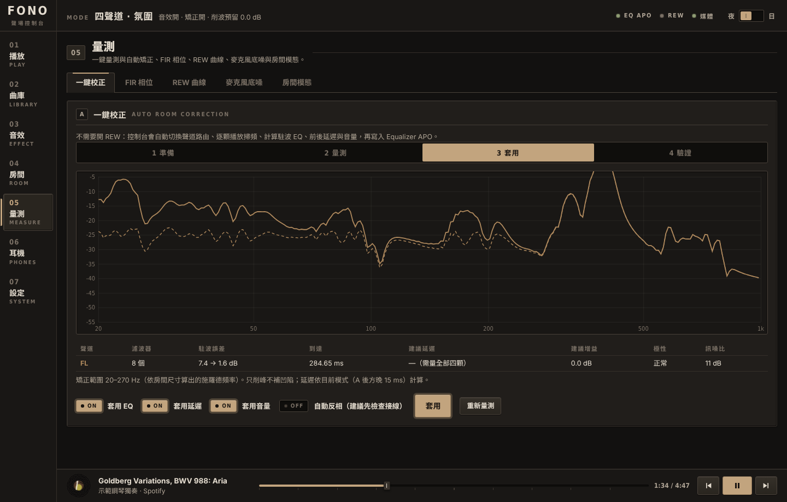
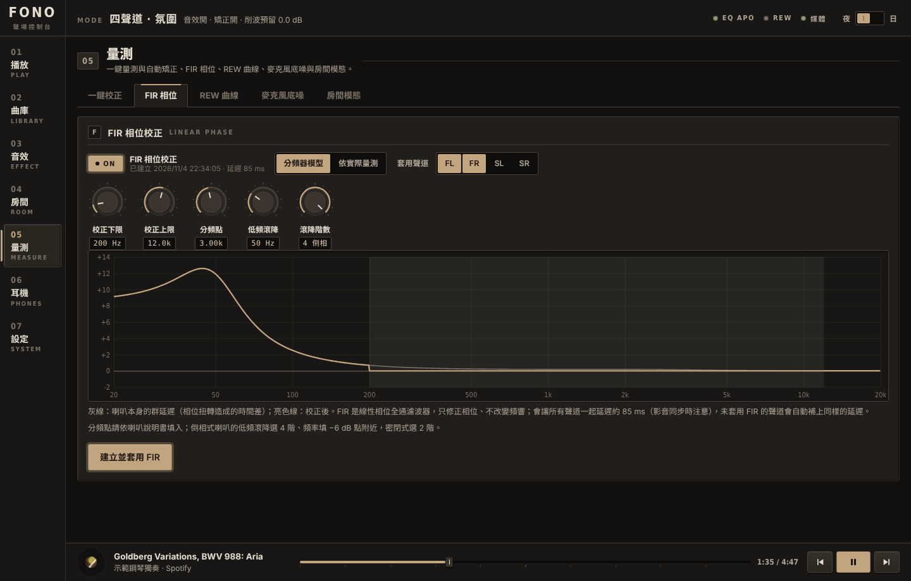
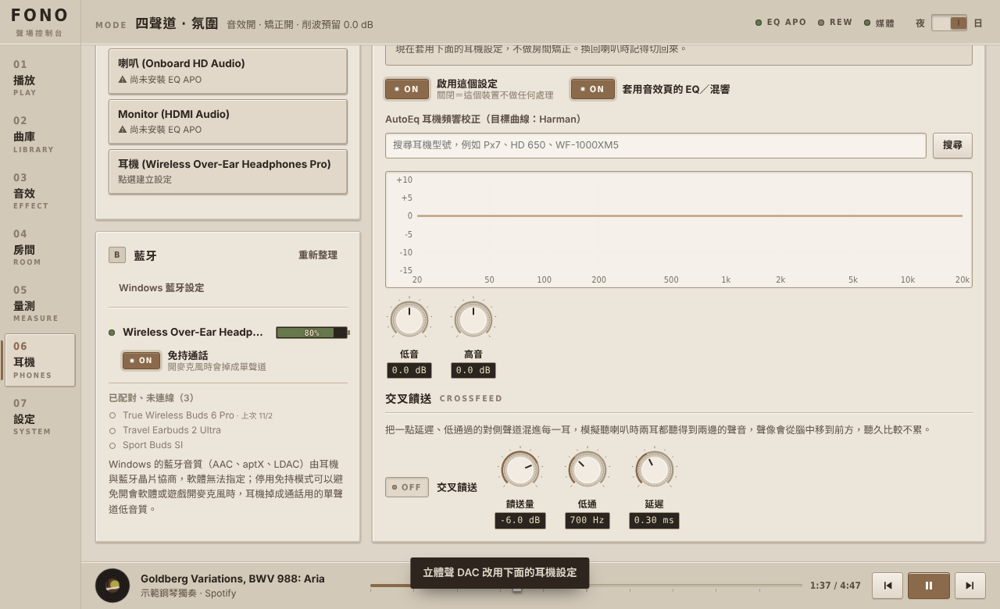

# Fono Console 教學

[English](tutorial.en.md) | [繁體中文](tutorial.zh-TW.md)

這份教學從零開始，依序是：裝好軟體、量測房間、校正、聽音樂、設定耳機。你不需要懂 REW 或 Equalizer APO 的語法。

---

## 0. 先搞懂三件事

**Equalizer APO 是引擎，Fono Console 是方向盤。**

- Equalizer APO 裝在 Windows 音訊驅動裡，所有聲音都會經過它。
- Fono Console 只負責產生它的設定檔（`fono_console.txt`），所以關掉 Fono Console 後效果仍在。

**校正主要修低頻。**

- 房間在約 300 Hz 以下會產生駐波：某些頻率特別轟，某些幾乎消失。這比喇叭之間的差異大得多，也是 EQ 最有效的地方。
- 高頻要靠擺位與吸音。
- Fono Console 只修施羅德頻率以下，而且**只削峰、不補凹陷**。凹陷是聲波互相抵銷造成的，加再多能量也補不回來，只會讓擴大機削波。

**兩個輸出裝置的分工。** 設定腳本會問你：

| 名稱 | 用途 | 例子 |
|---|---|---|
| 多聲道音效卡 | 四聲道模式：前 L/R + 後 SL/SR，各接一台擴大機 | USB 7.1 音效卡（CM6206 等）|
| 立體聲 DAC | 立體聲模式：只用前方一對喇叭，音質較好的 DAC | 任何 USB DAC |

只有一張卡也可以，兩個都填同一張。

**看懂介面：**

| 元件 | 怎麼看 | 怎麼操作 |
|---|---|---|
| 開關鍵（`ON` / `OFF`）| 亮起、寫著 ON = 開；暗的、寫著 OFF = 關 | 點一下切換 |
| 旋鈕 | 下方黑底小框是目前數值 | 上下拖曳；按住 Shift 微調；雙擊歸零 |
| 推桿 | 上方黑底小框是數值，中間一格亮線是 0 dB 位置 | 上下拖曳；雙擊歸零 |
| 分段鍵（例：立體聲／四聲道 A／四聲道 B）| 亮起的那格是目前選項 | 點選 |
| 頂端三個燈 | 綠 = 正常，黃 = 需要注意，灰 = 未連接 | — |

---

## 1. 安裝（約 10 分鐘）

1. 把 `FonoConsole.exe` 和 `scripts` 資料夾放在一起。
2. 雙擊 `scripts\setup.cmd`。每一步都會先說明再詢問：按 Enter 用預設值，輸入 `n` 跳過。

   | 步驟 | 會做什麼 | 你要做的事 |
   |---|---|---|
   | 1 安裝 | 複製到 `%LOCALAPPDATA%\Programs\FonoConsole`，建立捷徑 | 無 |
   | 2 Equalizer APO | 偵測是否已安裝；沒有就開下載頁 | 安裝時在 Device Selector **勾喇叭輸出，不要勾麥克風** |
   | 3 選裝置 | 列出所有播放裝置，標示是否裝了 EQ APO | 輸入號碼；可替四顆喇叭取名 |
   | 4 config.txt | 備份原檔，改成只有 `Include: fono_console.txt`，並讓你的帳號可寫入 | UAC 視窗按「是」 |
   | 5 REW | 偵測安裝位置（可跳過）| 無 |
   | 6 Spotify | 說明如何建立開發者 App | 貼上 Client ID |
   | 7 YouTube Music | 從 GitHub 下載桌面版、**比對 SHA-256**、開啟 API 伺服器 | 安裝後登入一次 |
   | 8 Chrome | 可選：關閉背景執行、開記憶體節省 | 預設不做 |
   | 9 寫入 | 存到 `%APPDATA%\FonoConsole\settings.json` | 無 |

3. 如果在第 2 步新增了裝置，**重新開機**。
4. 只想重做某一步：`scripts\setup.cmd -Step 6`（多步：`-Step 3,9`）。

### 1.1 Spotify 開發者 App（第 6 步細節）

只有曲庫功能（搜尋、開專輯、播放清單）需要這一步。播放控制、封面、進度不需要。

1. 到 <https://developer.spotify.com/dashboard> 用你的帳號登入，按 **Create app**。
2. Redirect URI 填：`http://127.0.0.1:47811/api/spotify/callback`。必須是 127.0.0.1，Spotify 不接受 localhost。
3. 勾 **Web API**，按 Save。到 Settings 複製 Client ID，貼回腳本。
4. 打開 Fono Console → `07 設定` → **連接 Spotify**。

> Spotify 2026 年的開發模式限制：
>
> - App 擁有者要有 Premium。
> - 只有你加入 User Management 的帳號能登入。
> - 別人的播放清單看不到曲目；自己建立或協作的可以。

### 1.2 YouTube Music（第 7 步細節）

- Fono Console 不爬網頁。它透過開源的 YouTube Music 桌面版（pear-desktop）內建的 API 伺服器連線，而這個伺服器只接受本機連線。
- 第一次在曲庫搜尋時，YouTube Music 會跳出授權視窗，按允許即可。

---

## 2. 量測前準備

- **麥克風位置**：放在主要聆聽位置、耳朵高度。用支架或疊書固定，不要手拿。
- **麥克風接在哪**：最好插在你要量測的同一張音效卡上，時間才會同步。不建議用筆電內建麥克風。
- **環境**：關冷氣、風扇和窗戶。`05 量測` → `麥克風底噪` 會告訴你訊噪比夠不夠；曲線跳動時，把「平均」改成 1 秒或 10 秒（功率平均），或「最大值保持」抓偶發噪音，按「重設」重新開始。
- **麥克風音量**：Windows 聲音設定 → 錄音 → 內容 → 等級，調到 70–90，並關掉「麥克風增強」與所有音效。
- **擴大機音量**：開到平常聽音樂偏大聲的位置。量測音量在精靈裡可調（預設 −12 dBFS）。
- **先調擺位再做 EQ**：
  - 喇叭離後牆 50 cm 以上。
  - 兩顆喇叭與你成等邊三角形，左右對稱。
  - `05 量測` → `房間模態` 輸入房間尺寸，可以看出哪些頻率會出問題。
- **確認接線**：`01 播放` 的模式旋鈕轉到「聲道識別」，用粉紅噪音逐一確認每個插孔接到哪顆喇叭。

---

## 3. 一鍵校正

`05 量測` → `一鍵校正` → **開始一鍵校正**

1. **準備**：選輸出裝置（多聲道卡）和輸入裝置（麥克風）、要量的聲道、麥克風位置數。1 個位置最快；3–5 個位置時，在頭部周圍 30 cm 內移動麥克風，結果較穩。
2. **量測**：每聲道約 10 秒。
   - Fono Console 會自動把聲音只導到單一喇叭，其他聲道靜音，所有效果暫時關閉。
   - 右聲道會同時送一段參考訊號，作為計時基準。
3. **看結果**：

   

   | 欄位 | 意思 |
   |---|---|
   | 濾波器 | 自動擬合的峰值 EQ 數量 |
   | 駐波誤差 | 與目標曲線的平均偏差（dB），格式是「校正前 → 校正後」 |
   | 到達 | 聲音從喇叭到麥克風的時間（相對值）|
   | 建議延遲 | 讓所有喇叭同時到達所需的延遲；**四顆都量過才會計算** |
   | 建議增益 | 讓各聲道音量一致；四聲道 A 模式的後方另外 −6 dB |
   | 極性 | 偵測到反相會標示，建議先檢查接線 |
   | 訊噪比 | 低於 15 dB 的結果不可靠，請重新量測 |

4. **套用**：可以分別選擇要套用 EQ、延遲、音量、自動反相。
5. **驗證**：再量一次，比對前後曲線。你也可以在 `01 播放` 用「房間矯正」開關即時 A/B 比較。

**低頻抬升**（預設 +2 dB）讓目標曲線在低頻略高，聽感較自然。喜歡乾淨的低頻就設 0。

---

## 4. FIR 相位校正

`05 量測` → `FIR 相位`

**為什麼需要：**

- 喇叭的分頻器與低頻滾降，會讓不同頻率的聲音「晚到」：低頻常比高頻晚數毫秒，鼓的瞬態就會變鈍。
- 一般的 EQ 也會改變相位。
- FIR 可以只修相位、不動頻率響應。

**兩種模式：**

| 模式 | 適合誰 |
|---|---|
| 分頻模型 | 沒有好的量測麥克風。輸入分頻點（說明書上會寫，兩音路書架喇叭多在 2–3.5 kHz）、低頻滾降頻率與階數（倒相式約 4 階）|
| 量測 | 已用一鍵校正量過，而且麥克風品質可靠 |

**調整與套用：**

- **修正範圍**：預設 200 Hz – 12 kHz。往下延伸可以修更多低頻相位，但延遲變大，前振鈴的風險也較高。
- **延遲**：所有取樣率都固定約 85 ms。沒有 FIR 的聲道會自動加同樣的延遲，保持同步。代價是看影片時口型會有一點點不同步；打遊戲建議關掉。
- 下方的圖：灰線是喇叭原本的群延遲（低頻晚到多少毫秒），亮色線是校正後，修正範圍內應該貼平在 0。

   

- 按 **建立並套用 FIR**：會產生 44.1 / 48 / 96 / 192 kHz 四組 WAV，Equalizer APO 依目前的取樣率自動選用。

---

## 4.5 ART 低頻主動校正（實驗）

小房間的低頻問題不只是「某些頻率太大聲」，更是「轟的尾巴拖太長」（駐波殘響）。一般 EQ 只能把峰削平，無法讓殘響變短。ART 讓一組「協助」喇叭送出精算過的聲音，把主喇叭在房間裡激起的駐波吸掉。協助喇叭可以是後方一對（4.x 配置），也可以是重低音（2.1、2.2、4.1、4.2，設定見 4.7）。2.0 與只有耳機的配置沒有協助喇叭，ART 分頁會直接告訴你需要什麼。

**開始前**：在 `設定 → 功能模組` 打開 **ART 低頻主動校正（實驗）**。這是實驗功能，預設關閉。分頁最上面有一個可展開的 **這是什麼？** 面板，用白話說明它做什麼、需要什麼、預期效果、限制與如何還原；第一次用建議先讀一遍。

### 流程

1. **量測（引導式）**：`量測 → 一鍵校正`，「麥克風位置數」選 **9 點（ART）** 或 **15 點（ART）**，「要量的喇叭」把這個配置的全部喇叭都選起來（含 SW1／SW2）。
   - 每一點開始前，畫面會顯示 3 × 5 的位置圖：上三排是水平面（上＝前方），下兩排是往上、往下 15 cm，亮起的格子就是下一個位置。第一點在頭的位置，其餘是前後左右 25 cm 與上下 15 cm。
   - 每個位置量完會做**品質檢查**：訊噪比至少 20 dB，而且低頻音量和鄰近位置（0.3 m 內）的差不超過 9 dB RMS。沒通過時會顯示「位置 N / M：這一點的量測品質不佳……」，這時可以按 **重量這一點** 只重做這一點，不必從頭來過；確定沒問題也可以按 **接受並繼續**。
   - 量測期間不要開冷氣、不要碰音量旋鈕、不要移動喇叭。
2. **設定**：到 **ART 低頻** 分頁。
   - **低頻由誰播**（只有配置裡有重低音時才會出現）：「前方主喇叭」（預設）或「重低音」。
   - **交接頻率**（預設 120 Hz）：以下由參與的喇叭一起處理。再高的話，室溫一變反而容易變差。
   - **最大推力**（預設 +12 dB）與 **低頻下限**（預設 35 Hz）。
   - **耐溫度變化設計**：同時照顧室溫 ±1% 的三種房間。
   - **自動正則化**（預設開）：每個頻帶用留一交叉驗證從一小組候選值中挑出 λ（濾波器的平緩程度）與推力上限，並把挑出的值列在結果下方。關掉就用固定值。
   - **保護喇叭**（預設開）：低於各喇叭 −10 dB 點、或訊噪比不足的頻率不加大推力，避免把小單體推爆。
   - **限制預振鈴**（預設關）：把協助喇叭 FIR 主波峰之前的能量壓到 −30 dB 以下；打開後結果會列出各喇叭「前 → 後」的預振鈴 dB。
   - **位置權重**（15 點時可展開）：預設中間重、外圍輕，可以逐點修改（0 = 完全不考慮），「還原預設權重」回到預設。
3. 按 **計算（N 點）**，看預估表（見下面「怎麼看預估」）。
4. 結果下方的細節會列出自動挑選的 λ 與推力上限，以及 **需要的前級衰減 X dB**：它讓每顆喇叭「直通加低頻濾波器」的最壞情況不超過 0 dBFS，套用時會自動加上，所以整體音量會小一點。
5. 滿意就按 **套用 ART**，聆聽模式會切到「ART 低頻」。在「房間」可以隨時切回其他模式比較。
6. **驗證**：下方的「驗證量測」選 3 點或 5 點，按 **驗證量測**。照畫面指示把麥克風放回原本的第 N 點，放穩後按 **開始量測這一點**。結束後會顯示：
   - **結論**：有改善／沒有明顯變化／變差了／資料不足，並附上「實測殘響時間變動多少（預測多少）」；
   - 校正前、預測、實測三列各頻帶的殘響時間，以及並排的長條圖；
   - 如果沒達到預期，會依情況建議：先確認麥克風位置與室溫、保持「自動正則化」開著、把交接頻率調低（例如 100 Hz 以下）、改用 9 點並確保每點放穩。

### 怎麼看預估

- 「預估：量測區域內」：每一點都用**其他點**算出的濾波器來預測（不偷看答案）。
- 「預估：室溫差 6 °C」：模態頻率偏移 1% 時，同一組濾波器的表現，比較接近日常。
- 綠色是改善、紅色是變差。

### 誠實的預期

- 在模擬臥室（3.6 × 3.0 × 2.6 m）裡，用其他位置預測被留下的位置：40–63 Hz 的殘響時間約縮短 25–50%，80 Hz 以上變化不大。**這些是模擬數字，不是保證**；真實房間的牆面材質、家具、喇叭位置都不同，效果可能比較小，也可能變差。
- 所以請以 **驗證量測** 的實測結論為準，不要只看預估表。如果結論是「變差了」或「沒有明顯變化」，到「房間」把模式切回「立體聲」或「四聲道」即可立刻關閉，濾波器檔案會保留。
- 示範網站沒有真的麥克風，驗證結果是用預測加上小幅溫度變化與雜訊模擬出來的，會標上「模擬」，只用來示範流程。

### 限制

- 只處理約 150 Hz 以下；再高的頻率，頭稍微動一下就會反效果。
- 室溫變化會讓駐波頻率飄移（約每 6 °C 偏 1%），效果跟著打折；移動大型家具、開關門窗也一樣，變動後要重新量。
- 需要安靜的房間量測；噪音會讓濾波器學到錯的東西。
- 不會增加低頻延伸，也不會把深凹陷補平；單體低頻下限以下不會加大推力。
- 在 ART 模式下，沒有 ART 濾波器的重低音會靜音。

原理、模擬與限制見 [research/art](../research/art/README.md)。

## 4.6 喇叭配置（耳機／2.0／2.1／2.2／4.0／4.1／4.2）

設定精靈在「選擇輸出裝置」之後會問你喇叭怎麼接，選好後沒用到的功能自動收起來（資料不會刪）。之後在 `07 設定 → 喇叭配置` 隨時可以改。數字的意思是「主喇叭．重低音」：2 = 前方一對，4 = 前後兩對；小數點後是重低音的數量。

| 配置 | 會變成怎樣 |
|---|---|
| 只有耳機 | 收起「房間」「量測」兩頁，耳機功能保持開啟 |
| 2.0 立體聲 | 聆聽模式固定為立體聲；四聲道與 Hafler 按鍵隱藏；後方聲道靜音；量測、FIR 只列 FL／FR；ART 分頁提示需要協助喇叭 |
| 2.1 立體聲＋重低音 | 前方一對加一顆重低音（SW1，接 LFE）；主喇叭高通、重低音低通；ART 可用重低音當協助喇叭 |
| 2.2 立體聲＋雙重低音 | 前方一對加兩顆重低音（SW1 接 LFE，SW2 預設接 C） |
| 4.0 前後兩對 | 全部功能（預設） |
| 4.1 前後兩對＋重低音 | 4.0 再加一顆重低音：四顆喇叭都高通，低頻交給重低音 |
| 4.2 前後兩對＋雙重低音 | 4.0 再加兩顆重低音，兩顆收同一個低頻訊號 |

換配置時，「要量的喇叭」清單會重設成新配置的全部喇叭（對新加的喇叭要重新量）。「幫我全部自動設定」不會改你選的配置。

---

## 4.7 重低音設定

2.1、2.2、4.1、4.2 配置多了一或兩顆重低音。控制台負責低音管理（誰播低頻）和時間對齊（重低音和主喇叭同時到耳朵）；**音量不會自動調，要你用耳朵或另外量測決定**。

### 接線與聲道

1. `設定 → 喇叭配置` 選配置（或在設定精靈的「喇叭配置」步驟點卡片）。
2. 接線：**SW1 接多聲道音效卡的 LFE 輸出，SW2 預設接 C**。Windows 的喇叭設定要選 5.1 或 7.1，LFE 才會有聲音。如果你的卡接法不同，到 `設定 → 聲道對應`，把「SW1 → EQ APO 聲道」「SW2 → EQ APO 聲道」改成實際的聲道。
3. 低音管理只在多聲道音效卡上運作；用立體聲 DAC 聽（立體聲模式走另一台 DAC）時，DAC 拿到的是全頻的前方一對。

### 低音管理（房間頁的「重低音」面板）

到 `04 房間`，「重低音」面板的控制項：

| 控制項 | 作用 |
|---|---|
| 分頻點 | 40–200 Hz，預設 80 Hz。主喇叭做 LR4（24 dB/oct）高通，重低音對 (L+R)/2 做 LR4 低通 |
| 重低音增益 | −24 到 +6 dB，所有重低音共用 |
| 延遲 | 0–40 ms，所有重低音共用 |
| 反相 | 反轉所有重低音的極性 |
| 重低音收單聲道 | 只在 2.2 出現。開（預設）時兩顆收同一個訊號；關閉時 SW1 收 L、SW2 收 R |
| 主喇叭保持全頻 | 主喇叭不高通，與重低音重疊 |

這一組增益、延遲、反相是加在每顆重低音自己的聲道條（「重低音 1」「重低音 2」）之上的。聲道條在房間頁最上面，和前後喇叭一樣有增益、延遲、反相與校正。

### 量測並自動對齊

1. `量測 → 一鍵校正`，「要量的喇叭」把 FL、FR（4.x 還有 SL、SR）和 SW1（2.2 還有 SW2）都選起來，照平常的方式量測。重低音只播低頻，所以量測音量不要設太高，也要確認它有接上擴大機。
2. 結果頁除了每個聲道的表格，多了 **重低音對齊** 區塊：
   - 表格列出每顆重低音的 **建議延遲**、**極性**（正相 0° 或反相 180°）與 **加總分數（前 → 後）**；
   - 方法：用實測的複數響應（含到達時間與相位），在分頻點的 0.5–2 倍範圍內，搜尋重低音的延遲（±10 ms，每 0.1 ms）與極性，使聽音位置的加總振幅最大；兩顆重低音依序對齊；
   - 如果重低音比主喇叭早到，主喇叭（前後全部）會再多延遲一點，重低音從 0 起算，文字會告訴你多延遲了幾毫秒；
   - 圖上亮線是套用對齊後的預測，灰線是延遲 0、正相。
3. 「套用重低音對齊」開關預設是開的，按 **套用** 就會把延遲與極性寫進各聲道條。房間頁的「重低音」面板會顯示「上次自動對齊：……」。
4. **音量**：用耳朵調「重低音增益」，或套用後再量一次比較。對齊是依量測算出的預測，不是保證，套用後用驗證量測或 4.8 的診斷確認。

### 之後怎麼檢查

量測後到 `量測 → 房間診斷`，會有一項「低音喇叭與主喇叭在 N Hz 銜接良好／不良」，不良時會建議調高或降低重低音增益、改延遲或試試反相（見 4.8）。

---

## 4.8 房間診斷與座位熱圖

`量測 → 房間診斷` 分頁把量測結果變成一份**依嚴重程度排序的白話清單**。它是核心功能，預設開啟（`設定 → 功能模組` 的「房間診斷」可以關掉）。

### 怎麼用

1. 還沒量測時，清單只有依房間尺寸與座位位置算出的項目（例如座位低頻起伏、低頻峰谷與房間模態的關係）。做過一次「一鍵校正」後，會再加入左右平衡、極性、反射、衰減與 EQ 限制等檢查。
2. 頂端的小標籤統計各嚴重程度的數量：**嚴重**、**中等**、**輕微**、**正常**。清單中每一項有一個嚴重程度的燈號、標題、白話說明，以及「建議」：具體要做什麼（例如「在 FL 加上 0.4 ms 延遲」「在反射點貼吸音板：距前牆 1.2 m、距左牆 0.5 m、高 1.1 m」）。
3. 動了房間尺寸、座位或喇叭位置後會自動更新；也可以按 **重新診斷**。
4. 按 **匯出報告 (HTML)** 會存下一份獨立的 HTML 檔：診斷結果、量測曲線和座位熱圖。用任何瀏覽器開啟，要存 PDF 就用瀏覽器的列印。

### 檢查的項目

- 左右喇叭的音量差與到達時間差（聲像會不會偏）；
- 喇叭極性有沒有接反；
- 30–200 Hz 最突出的峰與最深的谷，以及耳朵在這個房間模態的波腹還是節點；
- 座位的低頻起伏，以及往前後移多少可以改善；
- 6 ms 內高於 −10 dB 的早期反射，並用鏡像法算出反射點的位置；
- 訊噪比與錄音削波；
- 重低音與主喇叭在分頻點附近的銜接（有重低音時）；
- 各頻段殘響時間是否差很多；
- 自動 EQ 是否用滿濾波器或碰到下限。

這些全是固定規則，沒有用模型猜測；數字來自你的量測和房間模態模型。座位移動的建議是**預測，不是量測值**；改完請再量一次。

### 座位低頻熱圖

診斷分頁下方的 **座位低頻熱圖**（平面圖）依房間尺寸和目前的喇叭位置（有重低音時用重低音的位置），預測每一點 **30–120 Hz** 的低頻起伏：

- 顏色越暖，起伏越大；色條左右兩端標出數值範圍。
- 亮色外框圈出**最佳區域**（和最佳點差 0.5 dB 以內），黑點是目前座位（「耳」）。
- 下方一行字給出「目前座位 X dB RMS · 最佳點 Y dB RMS（距離 Z cm）」。
- 拖曳「耳」可即時看到數字變化；拖曳喇叭則會重算整張圖。
- 「低頻起伏熱圖」開關可以隨時關掉。同一張熱圖也出現在實驗室的房間平面圖上。

**限制**：模型是長方形房間的模態模型，所以房間尺寸與位置要輸入正確（`房間模態` 分頁，需在功能模組打開）；座位在牆邊 25 cm 內時，熱圖不涵蓋。熱圖看的是「哪裡的低頻比較均勻」，不會告訴你高頻或反射。

---

## 4.9 自訂外觀與版面

1. `07 設定 → 外觀`：
   - **配色**：十種預設與一組自訂（自己選背景、面板、文字、強調色、表燈；對比不足會警告）。
   - **材質**：面板、側欄、頂欄的紋理（顆粒、髮絲紋、木紋、皮革、毛氈、亞麻、紙張、碳纖維、老漆龜裂），可調強度。
   - **桌布**：內建像素與版畫風景，或上傳 8 MB 以內的圖片；可調壓暗、模糊、面板透明度。
   - **播放頁**：唱盤、卡帶、大型 VU 表、大封面、極簡；黑膠有十種顏色，卡帶外殼可選；儀表有指針、LED、輝光管。
   - 「匯出主題／匯入主題」可以分享整組外觀。
2. 右上角 **編輯版面**：每個面板都能拖曳、縮放、隱藏；導覽列可排序或隱藏頁面。按 `Esc` 或「完成編輯」結束。
3. 編輯版面時導覽列下方有 **＋ 新增分頁**：建立自訂分頁後按「＋ 新增小工具」，從目錄挑正在播放、迷你唱盤、VU 表、快速開關、時鐘、睡眠計時器、SPL／擴大機搭配／距離延遲／房間駐波速算、測試音、便條等。
4. `設定 → 版面與小工具` 可以匯出、匯入或還原整個版面。

---

## 5. 聆聽模式

在 `01 播放` 用模式旋鈕切換：

| 模式 | 說明 |
|---|---|
| 立體聲 | 只用立體聲 DAC 與前方喇叭，最純 |
| 四聲道 A | 前方正常，後方 −6 dB、延遲 15 ms，像在較大的空間裡 |
| 四聲道 B | 前後同等音量，適合背景音樂、派對 |
| 氛圍（Hafler）| 後方只播左右聲道的差訊號：錄音裡的殘響與空間感從後方出來，人聲仍留在前方 |
| 聲道識別 / 量測路由 | 接線檢查與量測用 |

切換模式時會自動切換 Windows 的預設輸出裝置。不想要的話，可以在 `07 設定` 關閉「自動切換預設輸出」。

---

## 6. 耳機與藍牙

`06 耳機`：每個非喇叭的輸出裝置（有線耳機、藍牙耳機、USB 耳擴）各有一組設定。Windows 切換到哪個裝置，就套用哪組。

- **立體聲 DAC 也能接耳機**：如果你的 DAC 有耳機孔，它也會出現在清單裡，上方多一個「這台 DAC 目前接：喇叭／耳機」切換。Equalizer APO 分不出插的是喇叭還是耳機，所以插耳機聽時切到「耳機」，DAC 就改用耳機設定、不做房間矯正；換回喇叭時切回來。
- 多聲道音效卡只用來接喇叭，不會出現在這裡。

1. 如果顯示「這個裝置還沒安裝 Equalizer APO」，按 **開啟 Device Selector** 勾選它，然後重新開機。
2. **AutoEq**：輸入耳機型號搜尋（資料來自 AutoEq 專案，目標曲線為 Harman），點選即可套用。
3. **低音 / 高音**：依喜好微調。
4. **交叉饋送**：把少量延遲、低通過的對側聲音混進來，模擬聽喇叭時兩耳都聽得到兩邊。長時間聆聽較不累，聲像也會從腦中移到前方。

**藍牙清單：** 只有連線中的耳機會顯示電量與免持開關；已配對但沒連線的裝置收在下方灰色清單，附上次連線日期。

**藍牙注意事項：**

- 編碼（AAC、aptX、LDAC）由 Windows 與耳機自行協商，軟體無法指定。
- 只要有程式開啟麥克風（例如 Discord、會議軟體），藍牙就會切成「免持」模式，變成單聲道的低音質。如果你不需要用耳機麥克風，在這頁停用該耳機的免持功能即可。

---

## 7. 曲庫

`02 曲庫`：上方選來源（全部 / Spotify / YouTube Music）與類型（歌曲 / 專輯 / 播放清單）。

- 搜尋結果以唱片封套排列。點封套，唱片會滑出，下方展開曲目。
- 按 **播放全部**，或點任何一首從該首開始播放。
- 播放前會自動暫停另一個播放器，所以兩個來源可以無縫切換。
- 頁面也會列出「其他播放器」：瀏覽器、foobar2000、MusicBee 等支援 Windows 媒體控制的程式，一樣可以在這裡控制。

---

## 8. 常見問題

**沒有聲音，或效果沒作用**
到 `07 設定` 看 Equalizer APO 狀態。如果裝置沒裝 EQ APO，跑 Device Selector 勾選它並重開機。

**改設定沒反應**
通常是權限問題。到 `07 設定` 按 **授予寫入權限**，或重跑 `setup.cmd -Step 4`。

**量測抓不到訊號，或訊噪比很低**
參考第 2 節的「麥克風音量」設定。

**後方喇叭沒聲音**
Windows 聲音設定 → 該裝置 → 設定 → 選 **7.1 環繞**（不是 5.1 或立體聲）。多數 7.1 USB 卡的「後方」插孔是 SL/SR；如果你的卡不同，到 `07 設定` → 聲道對應修改。

**延遲聽起來不對**
延遲只有在四顆都量過時才會套用。也可以用「聲道識別」確認前後有沒有接反。

**想完全還原**

- 把 `C:\Program Files\EqualizerAPO\config\config.backup-*.txt` 改名回 `config.txt`。
- 設定 → 應用程式 → 移除「Fono Console」。設定檔會保留在 `%APPDATA%\FonoConsole`，可手動刪除。
- Chrome 政策：執行 `setup.cmd -UndoChrome`。

**Chrome 或其他 App 開了很多程序**
Chromium 的架構是：每個分頁、每個擴充功能、GPU 與網路服務各自一個程序，所以 20 個以上是正常的。真正影響記憶體的是擴充功能數量與背景常駐。設定腳本第 8 步可以幫你關閉背景常駐，並開啟記憶體節省模式。

---

## 8.5 實驗室與進階量測

在 `設定 → 功能模組` 打開。核心功能預設開啟，實驗功能預設關閉。

- **目標曲線編輯器**（量測頁）：拖曳節點、選預設（平直、房間曲線、暖、亮），自動 EQ 追著它走。
- **衰減分析**（量測頁「衰減」分頁）：每個倍頻帶的 EDT、T20、T30，以及 20 Hz–1 kHz 的瀑布圖。
- **麥克風配對**：兩支麥克風放同一點量同一顆喇叭，存成差異曲線；也能匯入 UMIK 類 `.txt` 校正檔。每支麥克風先靜音量底噪 10 秒（倒數中請保持安靜），再掃頻 1／2／4／8 次（預設 4）；各次對齊主峰後相干平均，並顯示「重複性 ±x dB」（100 Hz–10 kHz 超過 1 dB 會警告）。訊噪比低於 15 dB 的頻段視為不可靠：圖上以灰底標示，儲存的校正在那裡是 0 dB，邊緣有 1/3 倍頻程漸變。量測中可按「取消」。
- **早期反射**與**房間掃描**：輸入或匯入房間尺寸，在平面圖拖曳座位與喇叭，看吸音板該放哪裡，以及座位落在哪些房間模態的節點，並建議移動多少。
- **等響度補償**（音效頁）：小聲聽時依 ISO 226 補回低音與高音。
- **ART**：穩健化（同時照顧室溫 ±1% 的三種房間）、前後預估報告圖，以及 ART 與一般校正並用。
- **無訊號防呆**：量測時若錄不到掃頻聲音，會停下來告訴你是擴大機、輸入選擇或音量的問題。

---

## 9. 進階：搭配 REW

REW 能看瀑布圖、RT60，做更細的分析。

1. 在 REW 開啟 API：Preferences → API → Start server。
2. 到 Fono Console 的 `05 量測` → `REW`，就能讀取 REW 的量測與 EQ 濾波器，並一鍵套用到指定聲道。

Fono Console 產生的 Equalizer APO 設定在 `config\fono_console.txt`，可以直接打開看，用的都是標準的 Equalizer APO 語法。
